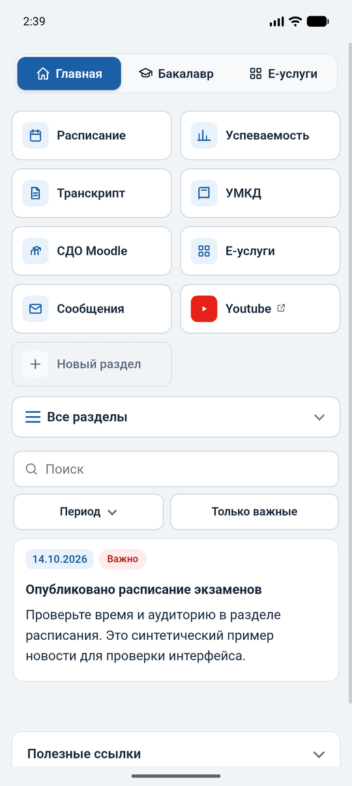
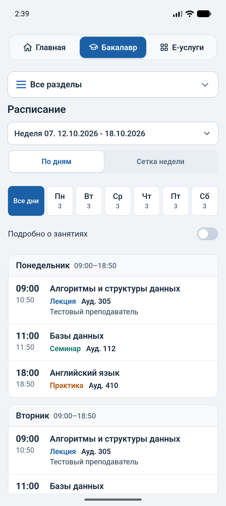
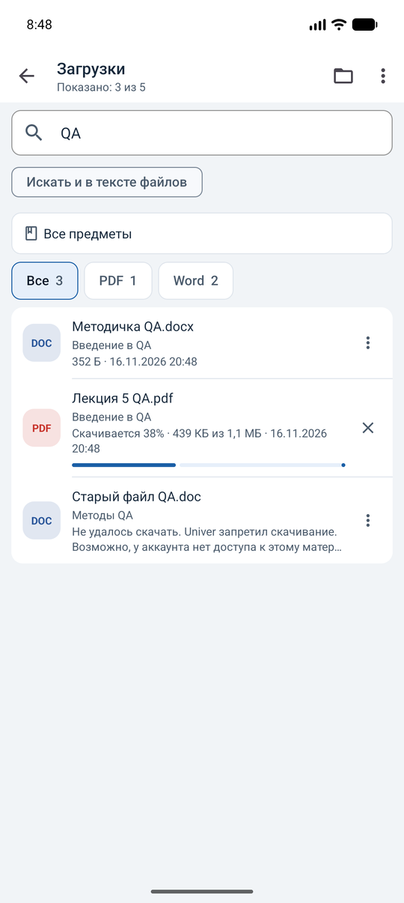
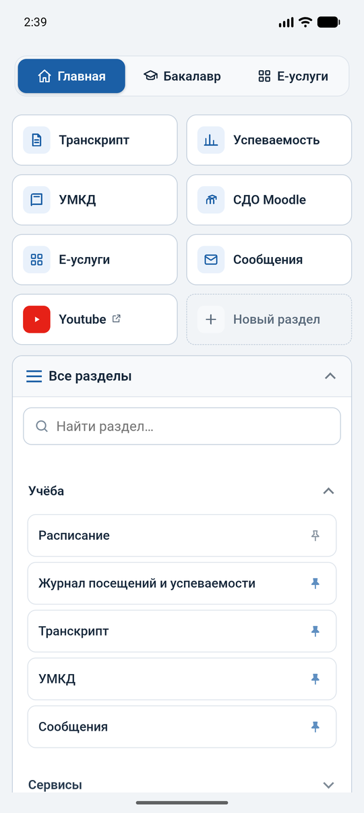

[Русский](README.md) · [Қазақша](README.kz.md) · **English**

# Simple Univer for Android

> **Unofficial app.** It is not affiliated with Al-Farabi KazNU and is not supported by the university. Sign-in, data and forms stay on [univer.kaznu.kz](https://univer.kaznu.kz/): the app opens the real site in a built-in WebView and makes it convenient on a phone.

An app for the [Univer KazNU](https://univer.kaznu.kz/) student account with the same features as [Simple Univer for Windows](https://github.com/SSSox/Simple-UniverKazNU-Desktop). On the phone it is called "Univer · KazNU". It has no server, analytics or ads of its own, and the interface is in Russian, Kazakh and English.

[](https://github.com/SSSox/Simple-UniverKazNU-Android/releases/latest) [](https://github.com/SSSox/Simple-UniverKazNU-Android/releases) [](#installation) [](LICENSE)

**[Download the latest version](https://github.com/SSSox/Simple-UniverKazNU-Android/releases/latest)** · [Installation](#installation) · [Privacy](PRIVACY.en.md) · [Security](SECURITY.en.md)

<p align="center">
  
  
  
</p>

## Features

### The account, easier to use

- **Sign-in without retyping.** The login and password are stored only on the phone, encrypted. When the site session ends, the app signs in again through the site's own form.
- **Mobile layout of the site.** Schedule, grades, assessment, UMKD and distance-course tables are shown as cards. The look follows the Windows version: section tiles, segmented controls with a sliding thumb, grade chips, one lesson layout on the Bachelor page and in the schedule. While a page loads, an outline stands in its place; for the main sections it follows their layout. Back usually brings the previous page from memory without loading it again. Turning off "Mobile website layout" in the menu brings back the site's own page unchanged.
- **Site notifications.** The bell collects the site's marks, for example "Анкетирование студентов (2)" (student questionnaires). Questionnaires the student has already answered are not shown.
- **Moodle (СДО Moodle)** opens inside the app: sign-in through Univer, attaching files and photos to assignments.
- **Links inside the app.** A teacher's page, Google Drive or a library opens in a separate window with its own cookies, apart from your Univer sign-in. The external browser can be turned on in Settings.
- **PIN code and biometrics** (optional), Russian, Kazakh and English, light and dark theme, text size.

<p align="center">
  
</p>

### Schedule and studies

- **Study pages fitted to the phone.** The exam and Midterm timetable is laid out by day: the next exam comes first with the days left, each slot shows its time, type, teacher and room, and an open exam starts from its own button. Questionnaires show the answer scale and how many are filled in; the advisor gets a card with Write and Call buttons when the site lists contacts. The GPA calculator keeps the result at the bottom of the screen and folds the grade table into an expandable scale. Long memos fold, and empty lists of debts, FX retakes, GPA raising and appeals say plainly that they have no entries.
- **Scores with thresholds.** In the grades journal each total is coloured by its threshold: below 50 is short, 50–69 is admitted but the scholarship is at risk, 70–89 is good, 90 and above is excellent. A bar under the total marks 50, 70 and 90 and says how many points are missing to the nearest mark, for example "8 short of 70".
- **Grade report.** The "Share grades: PDF or image" button in the journal gathers every course of the term into a report that parents can read too: a PDF for printing and email, a PNG image for messengers (a long report goes as several images, one per page), or straight to a printer. Any app on the phone can send it.
- **Class topics and independent work.** The schedule uses the printed syllabus for your own programme and academic year. Classes are matched against all weeks of the group schedule; when the group's seminars fall on other weeks than in the syllabus, the nearest week is used, and the plan found is kept for the term. Independent work (СРО) appears beside the nearest seminar; consultations (СРОП) are omitted. Switches and collapsible sections have touch targets. The week list has "‹ ›" arrows, and the schedule block on the Bachelor page says, with the date, that today's classes are over.

### Files and updates

- **Downloads and file viewer.** UMKD files go to Downloads/Univer УМКД/course/section when the page identifies the course and section. The "Download all" button on a UMKD section saves every file of that section you do not have yet, without the teacher's links. Deleted, moved and renamed files leave the Downloads list by themselves. PDF, Word (.docx, .doc, .rtf), Excel (.xlsx, .xls), PowerPoint (.pptx, .ppt), web pages, images and text open inside the app. OpenDocument text is extracted for search; full viewing of those formats is not available. Names and types are checked against headers and content; each download is limited to 1 GiB.
- **Updates from GitHub.** On every launch the app checks for a new version and offers it in a dialog; it installs in a couple of taps. "Don’t show again" hides the dialog only for that version: the next one appears again, and it can still be installed from Settings.

The screenshots use demo data; no personal data is shown.

## Installation

Requirements:

- Android 7.0 (API 24) or later;
- an up-to-date Android System WebView or Chrome: the mobile layout scripts target Chromium 80+.

Steps:

1. Download `Simple-UniverKazNU.apk` from the **Releases** page of this repository.
2. Compare its SHA-256 checksum with the one in the `Simple-UniverKazNU.apk.sha256` file next to the APK:
   ```powershell
   Get-FileHash .\Simple-UniverKazNU.apk -Algorithm SHA256   # Windows
   ```
   ```bash
   sha256sum Simple-UniverKazNU.apk                           # Linux, macOS: shasum -a 256
   ```
3. Open the file on the phone and allow installation from this source when Android asks.
4. On first start choose between saving your Univer login and password for automatic sign-in and signing in manually on the website without saving a password.

**Signature.** Releases are signed with the "SOX Team" key: certificate `CN=SOX Team, O=SOX Team, C=KZ`, SHA-256 `0aa54a2d4714db17bc71b9a0a4d4bc7818cb57d91f10685200416bd2094732b9`. Check it with `apksigner verify --print-certs Simple-UniverKazNU.apk` from Android SDK Build Tools: the `certificate SHA-256 digest` line must match.

**Updating.** The app checks for new versions on GitHub at every launch and, when it finds one, shows a dialog with "Don’t show again", "Later" and "Install"; Settings has an "Updates" section with a check button. After "Install" the file is downloaded, verified and handed to the Android installer; the first time, Android asks you to allow installing from this app. "Later" hides the dialog until the app restarts. "Don’t show again" hides the dialog for this version: checks go on, the version stays in Settings, and the next version is offered again. A new APK installs over the old one and keeps the data. On Android 9 and 10, version 2.3.1 cannot update itself: its check wrongly reports a different signature. Download the new version from the Releases page and install it over the old app; there is no need to uninstall. A debug build (`app-debug.apk`) has to be uninstalled before installing the release: they have different signatures. Versions 2.3 and older are signed with the previous key, and the new version will not install over them: Android reports that the app was not installed because it conflicts with an existing package. Uninstall the old app, install the new one and sign in again. The saved sign-in, PIN code and downloads list have to be set up again; downloaded files stay in Downloads.

**Removing data.** "Settings" → "Sign out" (or the site's "Logout" link), after confirmation, ends the session: it erases the encrypted login and password, the PIN, cookies, website storage, cache and history. Language, theme and text size stay. Uninstalling removes the app's local data; files in the shared Downloads folder remain.

## Security and privacy

- The login and password are encrypted with AES-GCM under an Android Keystore key and never go into backups. With a PIN code the data is additionally locked with a PIN-derived key; after 10 wrong attempts the saved sign-in is erased.
- The app connects only to `univer.kaznu.kz` and to Moodle (`dl.kaznu.kz`, `dl.kaznu.edu.kz`), over HTTPS only. For updates it connects to GitHub (`github.com`, `*.githubusercontent.com`) without a login or cookies. The link window opens only the sites whose links the student tapped. Certificate checks are never turned off.
- The app does not load the Google Analytics tag the site puts on its pages, so Google Analytics does not receive which pages you open. The links window does not block it.
- The grade report is drawn on the phone, kept in the app's temporary folder and handed only to the app you pick. The file is deleted on sign-out, and once older than an hour at the next app start or new report.
- Automatic actions (sign-in, the known read notice and the additional agreement) run only on the exact address `https://univer.kaznu.kz`. The app submits no other forms.

Details: the [privacy policy](PRIVACY.en.md) and the [security policy](SECURITY.en.md). The security policy also explains how to report a vulnerability and what to check in the code.

## Building from source

You need:

- [Android Studio](https://developer.android.com/studio) with its bundled JDK (`jbr`);
- Android SDK Platform 37 and Platform Tools (installed through the SDK Manager).

Gradle 9.9.0 is downloaded by the `gradlew` wrapper itself; JDK 25 for the Gradle daemon is picked automatically ([gradle/gradle-daemon-jvm.properties](gradle/gradle-daemon-jvm.properties)). Android Gradle Plugin 9.5.1, with Kotlin built in. All dependencies are pinned in [gradle/libs.versions.toml](gradle/libs.versions.toml): only AndroidX, Material Components and kotlinx-coroutines.

**In Android Studio:** File → Open → the project folder, wait for Gradle Sync, choose the `app` configuration and press Run.

**From the command line** (in the project root):

```powershell
$env:JAVA_HOME = 'C:\Program Files\Android\Android Studio\jbr'
.\gradlew.bat :app:assembleDebug
```

```bash
export JAVA_HOME="/opt/android-studio/jbr"   # path to the jbr of your installation
./gradlew :app:assembleDebug
```

Build outputs:

| Task | File | Signature |
|---|---|---|
| `:app:assembleDebug` | `app/build/outputs/apk/debug/app-debug.apk` | debug key |
| `:app:assembleRelease` | `app/build/outputs/apk/release/app-release.apk` | key from `keystore.properties`; without it the APK is unsigned |
| `:app:bundleRelease` | `app/build/outputs/bundle/release/app-release.aab` | the same, for Google Play |
| `:app:assembleQa` | `app/build/outputs/apk/qa/app-qa.apk` | release build with R8 on the debug key: installs over debug and keeps the data |

**Release signing.** Create a `keystore.properties` file next to `settings.gradle.kts` (it is in `.gitignore` and never goes into the repository):

```properties
storeFile=C:/path/to/release.jks
storePassword=...
keyAlias=...
keyPassword=...
```

The release is built with R8 (code and resource shrinking); the rules are in [app/src/main/keepRules](app/src/main/keepRules).

## Checks

```powershell
.\gradlew.bat :app:testDebugUnitTest :app:lintDebug
```

Instrumented tests need a running emulator or phone. The tests work with local synthetic pages and send nothing to Univer:

```powershell
.\gradlew.bat :app:connectedDebugAndroidTest
# a single class:
.\gradlew.bat :app:connectedDebugAndroidTest "-Pandroid.testInstrumentationRunnerArguments.class=com.univerflow.kaznu.NoticesAndTablesQaTest"
```

The live-site TLS check is enabled only explicitly: the argument `-Pandroid.testInstrumentationRunnerArguments.univer.liveTls=true` for `NetworkSecurityConfigTest`. The large-presentation test is skipped if the `deck-photos.*` files are missing from `app/src/androidTest/assets/documents` (16 MB, not in the repository).

## How the code works

The app shows the real site: pages are neither copied nor replaced. The mobile layout is built on top of the site's DOM and is removed completely by the "Original" switch.

| Path | What is there |
|---|---|
| [MainActivity.kt](app/src/main/java/com/univerflow/kaznu/MainActivity.kt) | the site's WebView, "Back" navigation, linking the screen with the session and automation |
| [UniverViewModel.kt](app/src/main/java/com/univerflow/kaznu/UniverViewModel.kt) | app state (StateFlow), sign-out, account change, lock |
| [domain/](app/src/main/java/com/univerflow/kaznu/domain) | plain Kotlin without Android: rules for the PIN, notifications, downloads, home tiles |
| [data/](app/src/main/java/com/univerflow/kaznu/data) | storage: Keystore encryption ([CredentialVault.kt](app/src/main/java/com/univerflow/kaznu/data/CredentialVault.kt)), PIN ([LockVault.kt](app/src/main/java/com/univerflow/kaznu/data/LockVault.kt), [LockCrypto.kt](app/src/main/java/com/univerflow/kaznu/data/LockCrypto.kt)), settings |
| [web/](app/src/main/java/com/univerflow/kaznu/web) | address policy ([SitePolicy.kt](app/src/main/java/com/univerflow/kaznu/web/SitePolicy.kt)), WebView settings ([SecureWebSettings.kt](app/src/main/java/com/univerflow/kaznu/web/SecureWebSettings.kt)), sign-in automation and its limits ([AutomationController.kt](app/src/main/java/com/univerflow/kaznu/web/AutomationController.kt), [SessionGuard.kt](app/src/main/java/com/univerflow/kaznu/web/SessionGuard.kt)), mobile layout, when the page skeleton is shown ([PageCover.kt](app/src/main/java/com/univerflow/kaznu/web/PageCover.kt)), the client that stands in while a WebView closes ([RetiredWebViewClient.kt](app/src/main/java/com/univerflow/kaznu/web/RetiredWebViewClient.kt)), running page scripts and quoting JS strings ([PageEvaluation.kt](app/src/main/java/com/univerflow/kaznu/web/PageEvaluation.kt)) |
| [report/](app/src/main/java/com/univerflow/kaznu/report), [GradeReport.kt](app/src/main/java/com/univerflow/kaznu/domain/GradeReport.kt), [ScoreBand.kt](app/src/main/java/com/univerflow/kaznu/domain/ScoreBand.kt) | the grade report: score bands, PDF and PNG drawing, files in the cache and sharing ([ReportFlow.kt](app/src/main/java/com/univerflow/kaznu/main/ReportFlow.kt)) |
| [download/](app/src/main/java/com/univerflow/kaznu/download) | downloads to the phone's Downloads folder with a check of the server's response |
| [update/](app/src/main/java/com/univerflow/kaznu/update), [Updates.kt](app/src/main/java/com/univerflow/kaznu/domain/Updates.kt) | checking and installing updates from GitHub: versions, allowed addresses, SHA-256 and signature |
| [preview/](app/src/main/java/com/univerflow/kaznu/preview) | built-in PDF, Word, Excel, PowerPoint and HTML readers; OpenDocument text extraction for search |
| [ui/](app/src/main/java/com/univerflow/kaznu/ui), [main/](app/src/main/java/com/univerflow/kaznu/main) | native screens: "Downloads", file viewer, PIN, settings, notifications, the page skeleton while loading ([PageSkeleton.kt](app/src/main/java/com/univerflow/kaznu/ui/PageSkeleton.kt)), the status strip under the app bar ([StatusBanner.kt](app/src/main/java/com/univerflow/kaznu/main/StatusBanner.kt)), screen coroutines: a failure becomes a message, cancellation is no error ([Coroutines.kt](app/src/main/java/com/univerflow/kaznu/ui/Coroutines.kt)), the Downloads cards ([DownloadsAdapter.kt](app/src/main/java/com/univerflow/kaznu/ui/DownloadsAdapter.kt)), the document window frame ([DocumentPanel.kt](app/src/main/java/com/univerflow/kaznu/ui/DocumentPanel.kt)), two-finger zoom in the file viewer ([LayoutPinch.kt](app/src/main/java/com/univerflow/kaznu/ui/LayoutPinch.kt)), the site notification check ([NoticeFlow.kt](app/src/main/java/com/univerflow/kaznu/main/NoticeFlow.kt)), network tracking ([NetworkWatch.kt](app/src/main/java/com/univerflow/kaznu/main/NetworkWatch.kt)), erasing the site data on logout ([SiteData.kt](app/src/main/java/com/univerflow/kaznu/main/SiteData.kt)) |
| [assets/](app/src/main/assets) | JavaScript for the site's pages: sign-in ([univer-automation.js](app/src/main/assets/univer-automation.js)), mobile layout and its styling ([univer-style.js](app/src/main/assets/univer-style.js), segment thumbs in [univer-kit.js](app/src/main/assets/univer-kit.js)), notifications ([univer-notices.js](app/src/main/assets/univer-notices.js)), phone study pages ([univer-screens.js](app/src/main/assets/univer-screens.js)) |
| [res/xml/network_security_config.xml](app/src/main/res/xml/network_security_config.xml) | trusted certificates: the system ones, plus Sectigo R46 for `univer.kaznu.kz` only and ISRG Root X1 only for update files on `*.githubusercontent.com` |
| [app/src/test](app/src/test), [app/src/androidTest](app/src/androidTest) | unit tests and emulator tests with synthetic pages |

Sign-in uses the site's own form: the script fills the visible `#login_frm` fields and clicks its button, preserving password encryption and handlers. Limits are three full sign-ins per ten minutes and three AJAX renewals per minute. A first full-form refusal, AJAX refusal or timeout can recover on a newer document after at least one minute; an exhausted budget waits. Two consecutive full-form refusals, an account mismatch, unreadable credentials or explicit sign-out require user action. Recovery loads a safe GET and never replays a submitted POST.

## Limitations

- If the site introduces a CAPTCHA or two-factor check, they have to be passed manually.
- If the site's HTML changes noticeably, the mobile layout or automatic sign-in may stop working until the app is updated.
- On a very old WebView (below Chromium 80) the site opens, but the mobile layout and automation may not work.

## License

Copyright (C) 2026 the Univer · KazNU authors.

The code is distributed under the [GNU General Public License](LICENSE), version 3 or, at your option, any later version (GPL-3.0-or-later). You may use, modify and distribute it, but a modified version of the app must be released under the same license together with its source code.

The name, logo and materials of Al-Farabi KazNU are not covered by the license and belong to the university.
