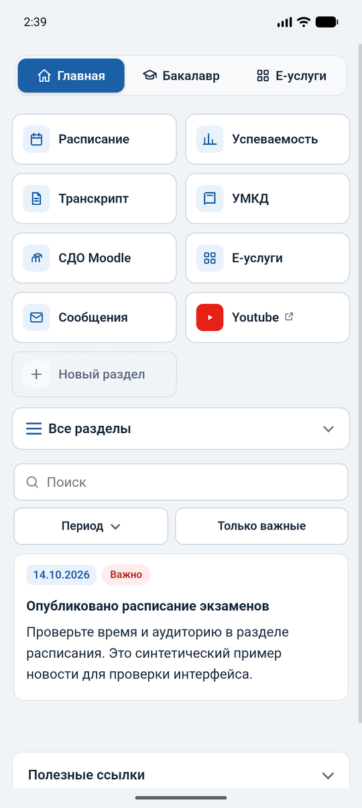
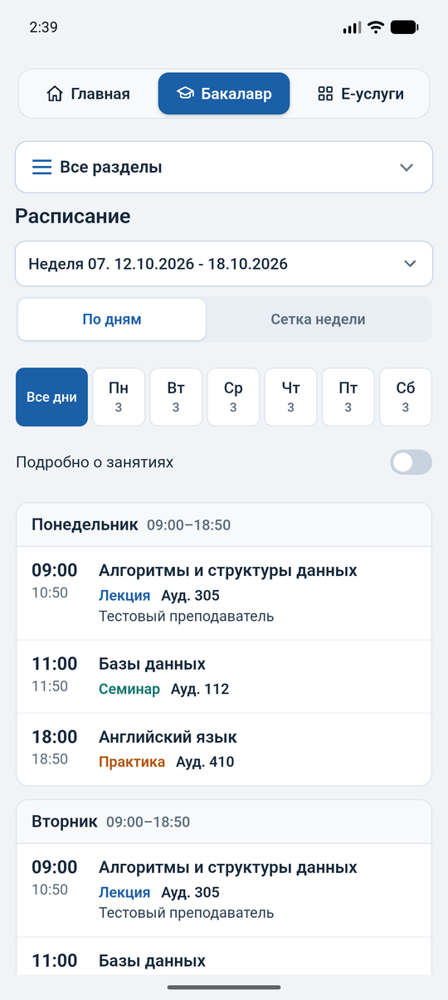
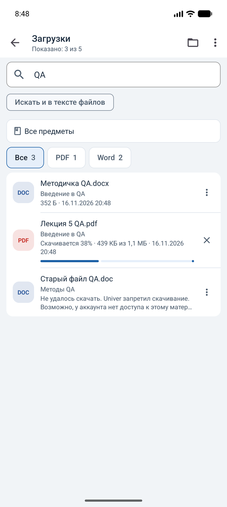
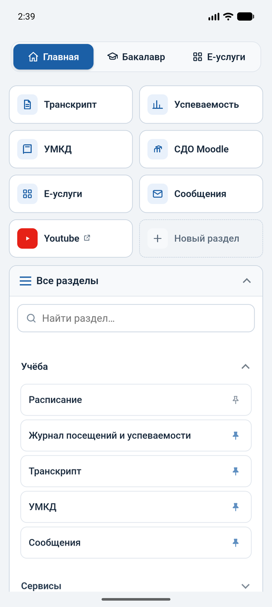

[Русский](README.md) · **Қазақша** · [English](README.en.md)

# Android үшін Simple Univer

> **Ресми емес қолданба.** Әл-Фараби атындағы ҚазҰУ-ға қатысы жоқ және университет қолдамайды. Кіру, деректер мен пішіндер [univer.kaznu.kz](https://univer.kaznu.kz/) сайтында қалады: қолданба нағыз сайтты кірістірілген WebView ішінде ашып, оны телефонға ыңғайлы етеді.

[Univer ҚазҰУ](https://univer.kaznu.kz/) студент кабинетіне арналған қолданба, мүмкіндіктері [Windows үшін Simple Univer](https://github.com/SSSox/Simple-UniverKazNU-Desktop) нұсқасымен бірдей. Телефонда ол «Univer · ҚазҰУ» деп аталады. Оның өз сервері, аналитикасы мен жарнамасы жоқ, интерфейсі орыс, қазақ және ағылшын тілдеріне аударылған.

[](https://github.com/SSSox/Simple-UniverKazNU-Android/releases/latest) [](https://github.com/SSSox/Simple-UniverKazNU-Android/releases) [](#орнату) [](LICENSE)

**[Соңғы нұсқаны жүктеу](https://github.com/SSSox/Simple-UniverKazNU-Android/releases/latest)** · [Орнату](#орнату) · [Құпиялылық](PRIVACY.kz.md) · [Қауіпсіздік](SECURITY.kz.md)

<p align="center">
  
  
  
</p>

## Мүмкіндіктер

### Ыңғайлы кабинет

- **Қайта енгізусіз кіру.** Логин мен құпия сөз тек телефонда шифрланған күйде сақталады. Сайттағы сессия аяқталғанда қолданба сайттың өз пішіні арқылы қайта кіреді.
- **Сайттың мобильді көрінісі.** Сабақ кестесі, үлгерім, аттестация, ОӘК және қашықтан оқыту курстарының кестелері карточкалар түрінде көрсетіледі. Безендірілуі Windows нұсқасын қайталайды: бөлім тақтайшалары, жылжымалы сегменттер, баға чиптері, «Бакалавр» бетінде және кестеде сабақтың бірдей көрінісі. Бет жүктеліп жатқанда оның орнында контур көрінеді: негізгі бөлімдерде ол бет құрылымын қайталайды. «Артқа» әдетте алдыңғы бетті жадтан, қайта жүктемей ашады. Мәзірде «Сайттың мобильді көрінісі» өшірілсе, сайттың бастапқы беті өзгеріссіз қайтады.
- **Сайт хабарландырулары.** Қоңырау сайттың белгілерін жинайды, мысалы «Анкетирование студентов (2)» (студенттер сауалнамасы). Студент жауап берген сауалнамалар көрсетілмейді.
- **СДО Moodle** қолданбаның ішінде ашылады: Univer арқылы кіру, тапсырмаларға файлдар мен фото тіркеу.
- **Сілтемелер қолданба ішінде.** Оқытушының беті, Google Диск немесе кітапхана өз cookies бар бөлек терезеде, Univer кіруінен бөлек ашылады. Сыртқы браузерді баптаулардан қосуға болады.
- **PIN-код және биометрия** (қалау бойынша), орыс, қазақ және ағылшын тілдері, ашық және қараңғы тақырып, мәтін өлшемі.

<p align="center">
  
</p>

### Кесте және оқу

- **Телефонға бейімделген оқу беттері.** Емтихан мен Midterm кестесі күндер бойынша көрсетіледі: жоғарыда жақын емтихан және оған дейінгі күн саны, әр уақытта түрі, оқытушысы мен аудиториясы бар, ашылған емтиханды өз батырмасы бастайды. Сауалнамада жауап шкаласы мен толтырылған анкеталар саны көрінеді, эдвайзерде сайт байланыс берсе «Жазу» және «Қоңырау шалу» батырмалары бар карточка шығады. GPA калькуляторы нәтижені экранның төменгі жағында ұстайды, бағалар кестесін ашылатын шкалаға жинайды. Ұзын жадынамалар жиналады, ал қарыздар, FX, GPA көтеру және өтініштердің бос тізімдері ішінде жазба жоқ екенін анық айтады.
- **Шектері бар балдар.** Үлгерім журналында әр қорытынды өз шегіне қарай боялады: 50-ден төмен: балл жетпейді; 50–69: рұқсат бар, бірақ стипендия қауіпте; 70–89: жақсы; 90 және жоғары: өте жақсы. Қорытынды астындағы жолақ 50, 70 және 90 белгілерін көрсетеді және жақын белгіге қанша балл жетпейтінін жазады, мысалы «70 шегіне 8 жетпейді».
- **Үлгерім есебі.** Журналдағы «Үлгерімді бөлісу: PDF не сурет» батырмасы семестрдің барлық пәнін ата-ана да түсінетін есепке жинайды: басып шығару мен поштаға PDF, мессенджерлерге PNG сурет (ұзын есеп бірнеше сурет болып, әр бетке біреуден жіберіледі) немесе бірден принтерге. Оны телефондағы кез келген қолданба арқылы жіберуге болады.
- **Сабақ тақырыптары және СӨЖ.** Кестеде өз білім беру бағдарламаңыз бен оқу жылыңызға сәйкес басылған силлабус тақырыптары көрсетіледі. Сабақтар топ кестесінің барлық апталарымен салыстырылады; топтың семинарлары силлабустағыдан басқа апталарға түссе, ең жақын апта алынады, табылған жоспар семестр бойы сақталады. СӨЖ (СРО) ең жақын семинардың жанында, СРОП кеңестері көрсетілмейді. Ауыстырғыштар мен жиналмалы бөлімдер түртуге бейімделген. Апталар тізімінің жанында «‹ ›» нұсқарлары бар, ал «Бакалавр» бетіндегі кесте блогы бүгінгі сабақтар біткенін күнімен жазады.

### Файлдар және жаңартулар

- **Жүктеулер және файлдарды қарау.** Бет пән мен бөлімді анықтаса, ОӘК материалдары «Жүктеулер/Univer УМКД/пән/бөлім» бумасына сақталады. ОӘК бөліміндегі «Барлығын жүктеу» батырмасы осы бөлімнің сізде әлі жоқ барлық файлдарын оқытушы сілтемелерінсіз сақтайды. Жойылған, жылжытылған және атауы өзгерген файлдар «Жүктеулер» тізімінен өздігінен кетеді. PDF, Word (.docx, .doc, .rtf), Excel (.xlsx, .xls), PowerPoint (.pptx, .ppt), веб-беттер, суреттер мен мәтін қолданба ішінде ашылады. OpenDocument мәтіні іздеу үшін алынады; бұл пішімдерді толық қарау жоқ. Атауы мен түрі тақырыптар және мазмұн бойынша тексеріледі; бір жүктеу шегі 1 ГиБ.
- **GitHub-тан жаңарту.** Қолданба әр іске қосылғанда жаңа нұсқаны тексеріп, оны терезеде ұсынады, ол екі-үш басумен орнатылады. «Қайта көрсетпеу» терезені тек осы нұсқа үшін жасырады: келесі нұсқа қайта шығады, ал оны баптаулардан орнатуға болады.

Скриншоттар демо-деректермен түсірілген, кадрда жеке деректер жоқ.

## Орнату

Талаптар:

- Android 7.0 (API 24) немесе жаңарағы;
- өзекті Android System WebView немесе Chrome: мобильді көрініс скрипттері Chromium 80+ үшін есептелген.

Қадамдар:

1. Осы репозиторийдің **Releases** бетінен `Simple-UniverKazNU.apk` жүктеңіз.
2. SHA-256 бақылау сомасын APK жанындағы `Simple-UniverKazNU.apk.sha256` файлындағымен салыстырыңыз:
   ```powershell
   Get-FileHash .\Simple-UniverKazNU.apk -Algorithm SHA256   # Windows
   ```
   ```bash
   sha256sum Simple-UniverKazNU.apk                           # Linux, macOS: shasum -a 256
   ```
3. Файлды телефонда ашып, Android сұрағанда осы көзден орнатуға рұқсат беріңіз.
4. Алғаш іске қосқанда автоматты кіру үшін Univer логині мен құпия сөзін сақтауды немесе құпия сөзді сақтамай сайт бетінде қолмен кіруді таңдаңыз.

**Қолтаңба.** Шығарылымдарға «SOX Team» кілтімен қол қойылған: сертификат `CN=SOX Team, O=SOX Team, C=KZ`, SHA-256 `0aa54a2d4714db17bc71b9a0a4d4bc7818cb57d91f10685200416bd2094732b9`. Оны Android SDK Build Tools құрамындағы `apksigner verify --print-certs Simple-UniverKazNU.apk` командасымен тексеруге болады: `certificate SHA-256 digest` жолы сәйкес келуі керек.

**Жаңарту.** Қолданба GitHub-тағы жаңа нұсқаларды әр іске қосылғанда тексеріп, жаңасы табылса, «Қайта көрсетпеу», «Кейінірек» және «Орнату» батырмалары бар терезе көрсетеді, ал баптауларда тексеру батырмасы бар «Жаңартулар» бөлімі бар. «Орнату» басылғаннан кейін файл жүктеліп, тексеріледі және Android орнатушысы ашылады; алғаш рет Android осы қолданбадан орнатуға рұқсат сұрайды. «Кейінірек» терезені қолданба қайта іске қосылғанша жасырады. «Қайта көрсетпеу» терезені осы нұсқа үшін алып тастайды: тексеру жалғасады, нұсқа баптауларда қалады, ал келесі нұсқа қайта ұсынылады. Жаңа APK ескісінің үстінен орнатылады, деректер сақталады. Android 9 және 10 жүйесінде 2.3.1 нұсқасы өзін жаңарта алмайды: оның тексерісі қолтаңба басқа деп қате хабарлайды. Жаңа нұсқаны Releases бетінен жүктеп, ескісінің үстінен орнатыңыз, қолданбаны жоюдың қажеті жоқ. Release орнатпас бұрын жөндеу құрастырмасын (`app-debug.apk`) жою керек: олардың қолтаңбалары әртүрлі. 2.3 және одан ескі нұсқаларға бұрынғы кілтпен қол қойылған, жаңа нұсқа олардың үстінен орнатылмайды: Android қолданба бар пакетпен қайшылыққа байланысты орнатылмағанын хабарлайды. Ескі қолданбаны жойып, жаңасын орнатыңыз да, қайта кіріңіз. Сақталған кіруді, PIN-кодты және жүктеулер тізімін қайта баптау керек болады, жүктелген файлдар «Жүктеулер» ішінде қалады.

**Деректерді қалай жоюға болады.** «Баптаулар» → «Аккаунттан шығу» (немесе сайттағы «Шығу» сілтемесі) растағаннан кейін сеансты аяқтайды: шифрланған логин мен құпия сөзді, PIN-кодты, cookies, сайт қоймасын, кэш пен тарихты өшіреді. Тіл, тақырып және мәтін өлшемі сақталады. Қолданбаны жойғанда оның жергілікті деректері өшеді, ортақ «Жүктеулер» бумасындағы файлдар қалады.

## Қауіпсіздік және құпиялылық

- Логин мен құпия сөз Android Keystore кілтімен AES-GCM арқылы шифрланады және сақтық көшірмелерге түспейді. PIN-кодпен деректер PIN-нен алынған кілтпен қосымша жабылады; 10 қате әрекеттен кейін сақталған кіру өшіріледі.
- Қолданба тек `univer.kaznu.kz` мекенжайына және СДО Moodle-ға (`dl.kaznu.kz`, `dl.kaznu.edu.kz`), тек HTTPS арқылы жүгінеді. Жаңарту үшін логинсіз және cookies-сіз GitHub-қа (`github.com`, `*.githubusercontent.com`) жүгінеді. Сілтемелер терезесі студент өзі басқан сілтемелердің сайттарын ғана ашады. Сертификат тексеруі өшірілмейді.
- Сайт өз беттеріне қоятын Google Analytics есептегішін қолданба жүктемейді, сондықтан Google Analytics сіз ашатын беттер туралы мәлімет алмайды. Сілтемелер терезесі оны бұғаттамайды.
- Үлгерім есебі телефонда салынады, қолданбаның уақытша бумасында тұрады және тек сіз таңдаған қолданбаға беріледі. Файл аккаунттан шыққанда, ал бір сағаттан ескісі келесі іске қосқанда не жаңа есеп жасағанда өшіріледі.
- Автоматты әрекеттер (кіру, белгілі «оқыдым» хабарламасы және қосымша келісім) тек `https://univer.kaznu.kz` нақты мекенжайында орындалады. Басқа пішіндерді қолданба жібермейді.

Толығырақ: [құпиялылық саясаты](PRIVACY.kz.md) және [қауіпсіздік саясаты](SECURITY.kz.md). Қауіпсіздік саясатында осалдық туралы қалай хабарлау керек және кодта нені тексеру керек екені де сипатталған.

## Бастапқы кодтан құрастыру

Қажет:

- кірістірілген JDK (`jbr`) бар [Android Studio](https://developer.android.com/studio);
- Android SDK Platform 37 және Platform Tools (SDK Manager арқылы орнатылады).

Gradle 9.9.0 нұсқасын `gradlew` қабықшасы өзі жүктейді; Gradle демонына арналған JDK 25 автоматты түрде таңдалады ([gradle/gradle-daemon-jvm.properties](gradle/gradle-daemon-jvm.properties)). Android Gradle Plugin 9.5.1, Kotlin оған кірістірілген. Барлық тәуелділіктер [gradle/libs.versions.toml](gradle/libs.versions.toml) ішінде бекітілген: тек AndroidX, Material Components және kotlinx-coroutines.

**Android Studio-да:** File → Open → жоба бумасы, Gradle Sync аяқталуын күтіп, `app` конфигурациясын таңдап, Run басыңыз.

**Пәрмен жолынан** (жоба түбірінде):

```powershell
$env:JAVA_HOME = 'C:\Program Files\Android\Android Studio\jbr'
.\gradlew.bat :app:assembleDebug
```

```bash
export JAVA_HOME="/opt/android-studio/jbr"   # орнатуыңыздағы jbr жолы
./gradlew :app:assembleDebug
```

Құрастыру нәтижелері:

| Тапсырма | Файл | Қолтаңба |
|---|---|---|
| `:app:assembleDebug` | `app/build/outputs/apk/debug/app-debug.apk` | жөндеу кілті |
| `:app:assembleRelease` | `app/build/outputs/apk/release/app-release.apk` | `keystore.properties` ішіндегі кілт, онсыз APK қол қойылмаған |
| `:app:bundleRelease` | `app/build/outputs/bundle/release/app-release.aab` | сол, Google Play үшін |
| `:app:assembleQa` | `app/build/outputs/apk/qa/app-qa.apk` | жөндеу кілтімен R8 бар release құрастырмасы: debug үстінен орнатылып, деректерді сақтайды |

**Release қолтаңбасы.** `settings.gradle.kts` жанында `keystore.properties` файлын жасаңыз (ол `.gitignore` ішінде және репозиторийге түспейді):

```properties
storeFile=C:/жол/release.jks
storePassword=...
keyAlias=...
keyPassword=...
```

Release R8 арқылы құрастырылады (код пен ресурстарды қысқарту); ережелер [app/src/main/keepRules](app/src/main/keepRules) ішінде.

## Тексерулер

```powershell
.\gradlew.bat :app:testDebugUnitTest :app:lintDebug
```

Аспаптық тесттер үшін іске қосылған эмулятор немесе телефон қажет. Тесттер жергілікті синтетикалық беттермен жұмыс істейді және Univer-ге ештеңе жібермейді:

```powershell
.\gradlew.bat :app:connectedDebugAndroidTest
# бір класс:
.\gradlew.bat :app:connectedDebugAndroidTest "-Pandroid.testInstrumentationRunnerArguments.class=com.univerflow.kaznu.NoticesAndTablesQaTest"
```

Тірі сайттың TLS тексеруі тек анық қосылады: `NetworkSecurityConfigTest` үшін `-Pandroid.testInstrumentationRunnerArguments.univer.liveTls=true` аргументі. `app/src/androidTest/assets/documents` ішінде `deck-photos.*` файлдары болмаса (16 МБ, репозиторийге кірмейді), үлкен презентациялар тесті өткізіліп жіберіледі.

## Код қалай құрылған

Қолданба нағыз сайтты көрсетеді: беттер көшірілмейді және ауыстырылмайды. Мобильді көрініс сайттың DOM-ы үстінен құрылады және «Түпнұсқа» ауыстырғышымен толық алынып тасталады.

| Жол | Онда не бар |
|---|---|
| [MainActivity.kt](app/src/main/java/com/univerflow/kaznu/MainActivity.kt) | сайттың WebView-і, «Артқа» навигациясы, экранды сессиямен және автоматтандырумен байланыстыру |
| [UniverViewModel.kt](app/src/main/java/com/univerflow/kaznu/UniverViewModel.kt) | қолданба күйі (StateFlow), шығу, аккаунтты ауыстыру, құлыптау |
| [domain/](app/src/main/java/com/univerflow/kaznu/domain) | Android-сыз таза Kotlin: PIN, хабарландырулар, жүктеулер, басты бет плиткаларының ережелері |
| [data/](app/src/main/java/com/univerflow/kaznu/data) | сақтау: Keystore шифрлау ([CredentialVault.kt](app/src/main/java/com/univerflow/kaznu/data/CredentialVault.kt)), PIN ([LockVault.kt](app/src/main/java/com/univerflow/kaznu/data/LockVault.kt), [LockCrypto.kt](app/src/main/java/com/univerflow/kaznu/data/LockCrypto.kt)), баптаулар |
| [web/](app/src/main/java/com/univerflow/kaznu/web) | мекенжайлар саясаты ([SitePolicy.kt](app/src/main/java/com/univerflow/kaznu/web/SitePolicy.kt)), WebView баптаулары ([SecureWebSettings.kt](app/src/main/java/com/univerflow/kaznu/web/SecureWebSettings.kt)), кіруді автоматтандыру және оның шектеулері ([AutomationController.kt](app/src/main/java/com/univerflow/kaznu/web/AutomationController.kt), [SessionGuard.kt](app/src/main/java/com/univerflow/kaznu/web/SessionGuard.kt)), мобильді көрініс, бет қаңқасын көрсету ережелері ([PageCover.kt](app/src/main/java/com/univerflow/kaznu/web/PageCover.kt)), WebView жабылған кездегі клиент ([RetiredWebViewClient.kt](app/src/main/java/com/univerflow/kaznu/web/RetiredWebViewClient.kt)), бет скрипттерін іске қосу және JS жолдарын экрандау ([PageEvaluation.kt](app/src/main/java/com/univerflow/kaznu/web/PageEvaluation.kt)) |
| [report/](app/src/main/java/com/univerflow/kaznu/report), [GradeReport.kt](app/src/main/java/com/univerflow/kaznu/domain/GradeReport.kt), [ScoreBand.kt](app/src/main/java/com/univerflow/kaznu/domain/ScoreBand.kt) | үлгерім есебі: балл шектері, PDF пен PNG салу, кэштегі файлдар және бөлісу ([ReportFlow.kt](app/src/main/java/com/univerflow/kaznu/main/ReportFlow.kt)) |
| [download/](app/src/main/java/com/univerflow/kaznu/download) | сервер жауабын тексере отырып, телефонның «Жүктеулер» бумасына жүктеу |
| [update/](app/src/main/java/com/univerflow/kaznu/update), [Updates.kt](app/src/main/java/com/univerflow/kaznu/domain/Updates.kt) | GitHub-тан жаңартуларды тексеру және орнату: нұсқалар, рұқсат етілген мекенжайлар, SHA-256 және қолтаңба |
| [preview/](app/src/main/java/com/univerflow/kaznu/preview) | PDF, Word, Excel, PowerPoint және HTML оқу құралдары; іздеуге OpenDocument мәтінін алу |
| [ui/](app/src/main/java/com/univerflow/kaznu/ui), [main/](app/src/main/java/com/univerflow/kaznu/main) | нативті экрандар: «Жүктеулер», файлдарды қарау, PIN, баптаулар, хабарландырулар, жүктеу кезіндегі бет қаңқасы ([PageSkeleton.kt](app/src/main/java/com/univerflow/kaznu/ui/PageSkeleton.kt)), панель астындағы күй жолағы ([StatusBanner.kt](app/src/main/java/com/univerflow/kaznu/main/StatusBanner.kt)), экран корутиндері: қате хабарламаға айналады, бас тарту қате емес ([Coroutines.kt](app/src/main/java/com/univerflow/kaznu/ui/Coroutines.kt)), «Жүктеулер» карточкалары ([DownloadsAdapter.kt](app/src/main/java/com/univerflow/kaznu/ui/DownloadsAdapter.kt)), құжат терезесінің жақтауы ([DocumentPanel.kt](app/src/main/java/com/univerflow/kaznu/ui/DocumentPanel.kt)), файлды қарауда екі саусақпен масштабтау ([LayoutPinch.kt](app/src/main/java/com/univerflow/kaznu/ui/LayoutPinch.kt)), сайт хабарландыруларын тексеру ([NoticeFlow.kt](app/src/main/java/com/univerflow/kaznu/main/NoticeFlow.kt)), желіні бақылау ([NetworkWatch.kt](app/src/main/java/com/univerflow/kaznu/main/NetworkWatch.kt)), шыққанда сайт деректерін өшіру ([SiteData.kt](app/src/main/java/com/univerflow/kaznu/main/SiteData.kt)) |
| [assets/](app/src/main/assets) | сайт беттеріне арналған JavaScript: кіру ([univer-automation.js](app/src/main/assets/univer-automation.js)), мобильді көрініс және оның безендірілуі ([univer-style.js](app/src/main/assets/univer-style.js), сегмент жүгірткілері [univer-kit.js](app/src/main/assets/univer-kit.js) файлында), хабарландырулар ([univer-notices.js](app/src/main/assets/univer-notices.js)), телефонға бейімделген оқу беттері ([univer-screens.js](app/src/main/assets/univer-screens.js)) |
| [res/xml/network_security_config.xml](app/src/main/res/xml/network_security_config.xml) | сенімді сертификаттар: жүйелік, сондай-ақ тек `univer.kaznu.kz` үшін Sectigo R46 және тек `*.githubusercontent.com` жаңарту файлдары үшін ISRG Root X1 |
| [app/src/test](app/src/test), [app/src/androidTest](app/src/androidTest) | синтетикалық беттері бар бірлік тесттері және эмулятордағы тесттер |

Кіру сайттың өз пішіні арқылы жүреді: скрипт `#login_frm` көрінетін өрістерін толтырып, батырмасын басады, шифрлау мен сайт өңдегіштері сақталады. Шектеулер: 10 минутта үш толық кіру және минутына үш AJAX қайта кіру. Толық пішіннің алғашқы бас тартуы, AJAX қатесі немесе тайм-ауттан кейін жаңа құжатта кемінде бір минуттан соң қалпына келу мүмкін; лимит біткенде қолданба күтеді. Толық пішін қатарынан екі рет бас тартса, аккаунт сәйкес келмесе, деректер оқылмаса немесе пайдаланушы шықса, оның әрекеті қажет. Тек қауіпсіз GET ашылады, жіберілген POST қайталанбайды.

## Шектеулер

- Сайт CAPTCHA немесе екі факторлы тексеру енгізсе, оларды қолмен өту керек.
- Сайттың HTML-і айтарлықтай өзгерсе, мобильді көрініс немесе автоматты кіру қолданба жаңартылғанша жұмыс істемей қалуы мүмкін.
- Өте ескі WebView-де (Chromium 80-нен төмен) сайт ашылады, бірақ мобильді көрініс пен автоматтандыру жұмыс істемеуі мүмкін.

## Лицензия

Copyright (C) 2026 Univer · ҚазҰУ авторлары.

Код [GNU General Public License](LICENSE) лицензиясының 3-нұсқасы немесе, сіздің таңдауыңыз бойынша, кез келген кейінгі нұсқасы (GPL-3.0-or-later) бойынша таратылады. Оны пайдалануға, өзгертуге және таратуға болады, бірақ қолданбаның өзгертілген нұсқасын сол лицензиямен бастапқы кодымен бірге шығару керек.

Әл-Фараби атындағы ҚазҰУ атауы, логотипі мен материалдары лицензияға кірмейді және университетке тиесілі.
