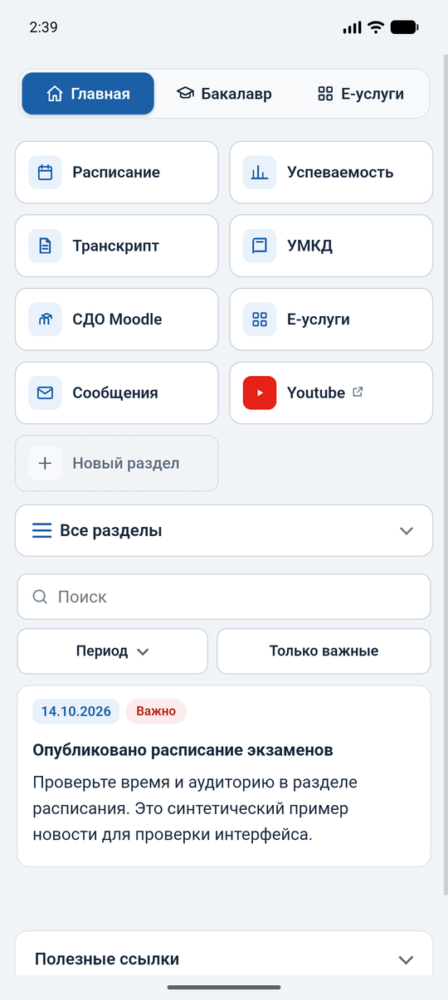
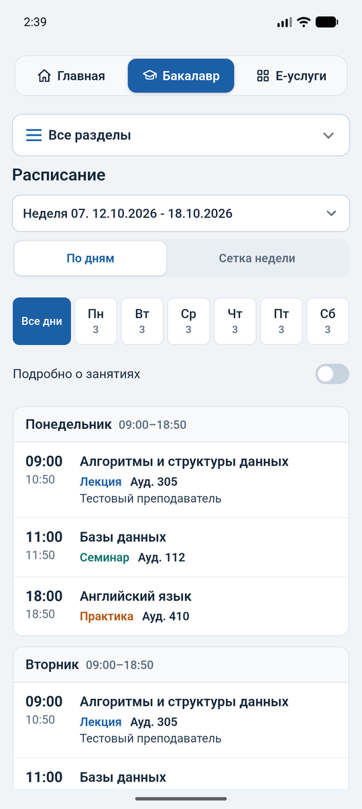
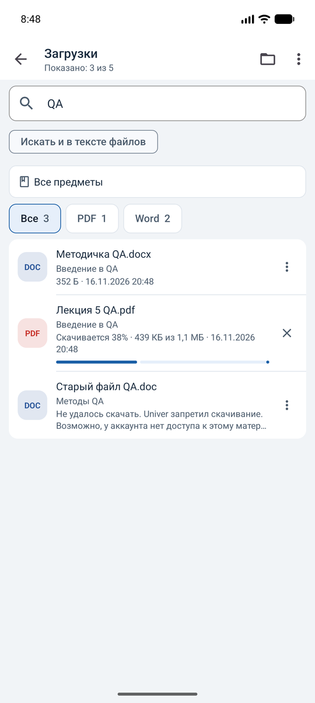
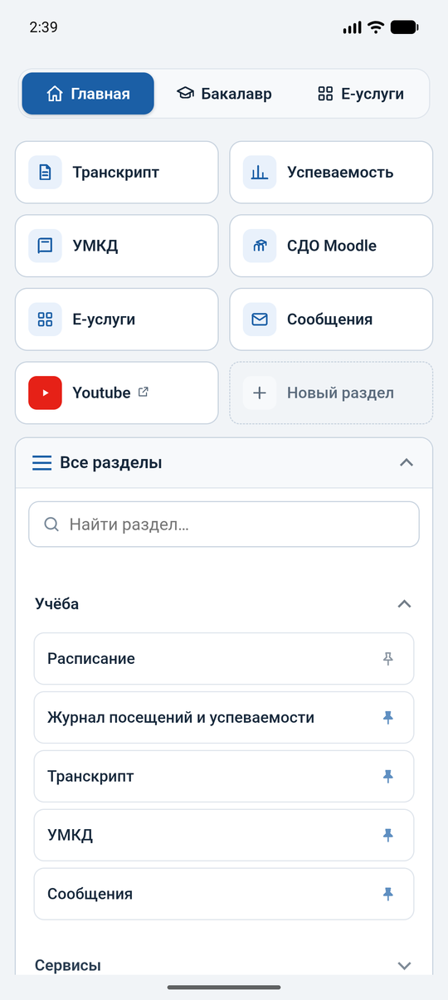

**Русский** · [Қазақша](README.kz.md) · [English](README.en.md)

# Simple Univer для Android

> **Неофициальное приложение.** Не связано с КазНУ им. аль-Фараби и не поддерживается университетом. Вход, данные и формы остаются на сайте [univer.kaznu.kz](https://univer.kaznu.kz/): приложение открывает настоящий сайт во встроенном WebView и делает его удобным на телефоне.

Приложение для кабинета студента [Univer КазНУ](https://univer.kaznu.kz/) с теми же возможностями, что и [Simple Univer для Windows](https://github.com/SSSox/Simple-UniverKazNU-Desktop). На телефоне оно называется «Univer · КазНУ». Своего сервера, аналитики и рекламы у него нет, интерфейс переведён на русский, казахский и английский.

[](https://github.com/SSSox/Simple-UniverKazNU-Android/releases/latest) [](https://github.com/SSSox/Simple-UniverKazNU-Android/releases) [](#установка) [](LICENSE)

**[Скачать последнюю версию](https://github.com/SSSox/Simple-UniverKazNU-Android/releases/latest)** · [Установка](#установка) · [Приватность](PRIVACY.md) · [Безопасность](SECURITY.md)

<p align="center">
  
  
  
</p>

## Возможности

### Кабинет в удобном виде

- **Вход без повторного ввода.** Логин и пароль хранятся только на телефоне в зашифрованном виде. Когда сессия на сайте заканчивается, приложение входит заново через форму самого сайта.
- **Мобильный вид сайта.** Таблицы расписания, успеваемости, аттестации, УМКД и дистанционных курсов показаны карточками. Оформление повторяет версию для Windows: плитки разделов, сегменты с ползунком, чипы оценок, один вид занятия в Бакалавре и в расписании. Пока страница грузится, на её месте виден контур: у основных разделов он повторяет их разметку. «Назад» обычно возвращает прошлую страницу из памяти, без новой загрузки. Если выключить «Мобильный вид сайта» в меню, вернётся исходная страница сайта без изменений.
- **Уведомления сайта.** Колокольчик собирает отметки сайта, например «Анкетирование студентов (2)». Анкеты, на которые студент уже ответил, не показываются.
- **СДО Moodle** открывается внутри приложения: вход через Univer, прикрепление файлов и фото к заданиям.
- **Ссылки в приложении.** Страница преподавателя, Google Диск или библиотека открываются в отдельном окне со своими cookies, отдельно от входа в Univer. Внешний браузер можно включить в настройках.
- **PIN-код и биометрия** (по желанию), русский, казахский и английский языки, светлая и тёмная тема, размер текста.
- **Стартовая страница.** В настройках можно выбрать, что открывается при запуске: новости (по умолчанию) или «Бакалавр», который загружается заметно быстрее.
- **Ярлыки на значке.** Долгое нажатие на значок приложения открывает расписание, успеваемость, УМКД или «Загрузки». С PIN-кодом раздел откроется только после ввода кода.
- **Обновление жестом.** Потяните страницу вниз, когда она уже в самом верху. Прокрутка таблиц, меню и окон страницу не обновляет, а если в форме набран текст, приложение не обновит страницу и скажет почему.

<p align="center">
  
</p>

### Расписание и учёба

- **Учебные страницы под телефон.** Расписание экзаменов и Midterm разложено по дням: сверху ближайший экзамен и сколько до него дней, у каждого слота время, тип, преподаватель и аудитория, а открытый экзамен запускается своей кнопкой. В анкетировании видна шкала ответов и сколько анкет заполнено, у эдвайзера есть карточка с кнопками «Написать» и «Позвонить», если сайт даёт контакты. Калькулятор GPA держит итог внизу экрана и убирает таблицу оценок в раскрывающуюся шкалу. Длинные памятки сворачиваются, а пустые списки задолженностей, FX, повышения GPA и обращений прямо говорят, что в них нет записей.
- **Баллы с порогами и цель.** В журнале успеваемости каждый итог окрашен по порогу: ниже 50 недобор, 50–69 допуск есть, но стипендия под риском, 70–89 хорошо, от 90 отлично. Полоса под итогом показывает метки 50, 70 и 90 и пишет, сколько осталось до ближайшей, например «ещё 8 до 70». Под сводкой по предметам можно выбрать цель: «Удовлетворительно», «Хорошо» или «Отлично». Тогда подсказка считает баллы до цели, а набранная цель отмечена словами «Цель достигнута». Пороги считаются от максимума каждой оценки: «Отлично» для РК из 25 начинается с 22,5.
- **Пропуски и новые оценки.** В карточке предмета видно, сколько занятий отмечено «н», с разбивкой по лекциям, семинарам и СРО. Оценка, которой не было при прошлом заходе в журнал, помечена «новое».
- **Уведомления о новых оценках** (по желанию, в настройках «Следить за оценками в фоне»). Через 10 минут после выхода из приложения оно открывает журнал одним запросом и сообщает о новой или изменённой оценке; пока вход на сайте жив, проверка повторяется раз в несколько часов. Пароль в фоне не вводится, а сайт сам завершает вход после недолгого простоя (на проверке меньше чем через 25 минут), поэтому дальше проверка ждёт, пока вы откроете приложение. С PIN-кодом уведомление пишет только «Появились новые оценки».
- **Отчёт об успеваемости.** Кнопка «Поделиться успеваемостью: PDF или картинка» в журнале собирает все предметы семестра в отчёт, понятный и родителям, вместе с выбранной целью и пропусками: PDF для печати и почты, картинка PNG для мессенджеров (длинный отчёт уходит несколькими картинками, по одной на страницу) или печать на принтер. Отправить можно через любое приложение телефона.
- **Расписание и оценки без сети, виджет и напоминания.** Неделя, которую вы открыли в расписании или в Бакалавре, сохраняется на телефоне, как и итоги из последнего открытого журнала. Без интернета на экране ошибки появляются кнопки «Расписание без сети» и «Последние оценки». Виджет «Пары на сегодня» показывает сегодняшние пары, текущая выделена, а после последней показаны пары на завтра. В настройках можно включить «Напоминать о парах» за 5, 10, 15 или 30 минут; тот же переключатель напоминает об экзаменах и рубежках из открытого расписания экзаменов или Midterm: накануне в 19:00 и перед началом. С PIN-кодом виджет и напоминания не называют предмет.
- **В календарь.** У экзамена и у пары в расписании есть кнопка «В календарь»: она открывает приложение календаря с готовым событием. Пара добавляется еженедельной серией до конца её периода, экзамен одним событием на два часа.
- **Темы занятий и СРО.** В расписании показаны темы из печатного силлабуса именно вашей образовательной программы и учебного года. Порядок занятий сверяется со всеми неделями расписания группы, если семинары группы идут на другой чётности, чем в силлабусе, берётся ближайшая неделя; найденный план хранится на семестр; СРО стоит рядом с ближайшим семинаром. СРОП не выводится. Переключатель и сворачиваемые блоки рассчитаны на касание. Рядом со списком недель есть стрелки «‹ ›», а блок расписания в Бакалавре пишет, что сегодняшние пары закончились, с датой.

### Файлы и обновления

- **Загрузки и просмотр файлов.** Материалы УМКД сохраняются в «Загрузки/Univer УМКД/дисциплина/раздел», если страница позволяет определить дисциплину и раздел. Кнопка «Скачать все» у раздела УМКД сохраняет все его файлы, которых ещё нет, без ссылок преподавателя. Удалённые, перемещённые и переименованные файлы сами уходят из списка «Загрузок», а скачанный файл можно удалить с телефона прямо из списка. PDF, Word (.docx, .doc, .rtf), Excel (.xlsx, .xls), PowerPoint (.pptx, .ppt), веб-страницы, картинки и текст открываются внутри приложения. Для OpenDocument извлекается текст для поиска; полноценного просмотра этих форматов нет. Имя и тип проверяются по заголовкам и содержимому; предел одного скачивания 1 ГиБ.
- **Обновления из GitHub.** При каждом запуске приложение проверяет новую версию и предлагает её в окне, ставится она в пару нажатий. «Больше не показывать» скрывает окно только для этой версии: следующая появится снова, а установить её можно в настройках.

Снимки экрана сделаны на демо-данных, личных данных в кадре нет.

## Установка

Требования:

- Android 7.0 (API 24) или новее;
- актуальный Android System WebView или Chrome: скрипты мобильного вида рассчитаны на Chromium 80+.

Шаги:

1. Скачайте `Simple-UniverKazNU.apk` со страницы **Releases** этого репозитория.
2. Сверьте контрольную сумму SHA-256 с той, что записана в файле `Simple-UniverKazNU.apk.sha256` рядом с APK:
   ```powershell
   Get-FileHash .\Simple-UniverKazNU.apk -Algorithm SHA256   # Windows
   ```
   ```bash
   sha256sum Simple-UniverKazNU.apk                           # Linux, macOS: shasum -a 256
   ```
3. Откройте файл на телефоне и разрешите установку из этого источника, когда Android спросит.
4. При первом запуске выберите: сохранить логин и пароль Univer для автоматического входа или войти вручную на странице сайта без сохранения пароля.

**Подпись.** Выпуски подписаны ключом «SOX Team»: сертификат `CN=SOX Team, O=SOX Team, C=KZ`, SHA-256 `0aa54a2d4714db17bc71b9a0a4d4bc7818cb57d91f10685200416bd2094732b9`. Сверить можно командой `apksigner verify --print-certs Simple-UniverKazNU.apk` из Android SDK Build Tools: строка `certificate SHA-256 digest` должна совпасть.

**Обновление.** Приложение проверяет новые версии на GitHub при каждом запуске и, если нашлась новая, показывает окно с кнопками «Больше не показывать», «Позже» и «Установить», а в настройках есть раздел «Обновления» с кнопкой проверки. После «Установить» файл скачивается, проверяется и открывается установка Android; в первый раз Android попросит разрешить установку из этого приложения. «Позже» скрывает окно до перезапуска приложения. «Больше не показывать» убирает окно для этой версии: проверка продолжается, версия остаётся в настройках, а следующая версия будет предложена снова. Новый APK ставится поверх старого, данные сохраняются. На Android 9 и 10 версия 2.3.1 не может обновиться сама: её проверка ошибочно сообщает о другой подписи. Скачайте новую версию со страницы Releases и установите поверх, удалять приложение не нужно. Отладочную сборку (`app-debug.apk`) перед установкой release нужно удалить: у них разные подписи. Версии 2.3 и более ранние подписаны прежним ключом, и новая версия поверх них не встанет: Android сообщит, что приложение не установлено из-за конфликта с существующим пакетом. Удалите старое приложение и установите новое, затем войдите заново. Сохранённый вход, PIN-код и список загрузок придётся настроить снова, скачанные файлы останутся в «Загрузках».

**Как убрать данные.** «Настройки» → «Выйти из аккаунта» (или ссылка «Выход» на сайте) после подтверждения завершает сеанс: стирает зашифрованные логин и пароль, PIN-код, cookies, хранилище сайта, кеш и историю. Язык, тема и размер текста остаются. При удалении приложения его локальные данные исчезают, но файлы в общей папке «Загрузки» остаются.

## Безопасность и конфиденциальность

- Логин и пароль шифруются AES-GCM ключом Android Keystore и не попадают в резервные копии. С PIN-кодом данные дополнительно закрыты ключом из PIN; после 10 неверных попыток сохранённый вход стирается.
- Приложение обращается только к `univer.kaznu.kz` и к СДО Moodle (`dl.kaznu.kz`, `dl.kaznu.edu.kz`), только по HTTPS. Для обновлений оно обращается к GitHub (`github.com`, `*.githubusercontent.com`) без логина и cookies. Окно ссылок открывает только те сайты, на ссылку которых нажал сам студент. Проверка сертификатов не отключается.
- Счётчик Google Analytics, который сайт ставит на свои страницы, приложение не загружает, поэтому Google Analytics не получает, какие страницы вы открываете. Окно ссылок его не блокирует.
- Сохранённая неделя расписания и, при включённых уведомлениях об оценках, последние итоги журнала лежат только в папке приложения и стираются при выходе из аккаунта. Фоновая проверка оценок делает один GET журнала на `univer.kaznu.kz` с cookies текущей сессии, форм не отправляет и в другие места не обращается.
- Отчёт об успеваемости рисуется на телефоне, лежит во временной папке приложения и передаётся только выбранному приложению. Файл стирается при выходе, а если ему больше часа, то при следующем запуске или новом отчёте.
- Автоматические действия (вход, известное уведомление о прочтении и дополнительное соглашение) выполняются только на точном адресе `https://univer.kaznu.kz`. Другие формы приложение не отправляет.

Подробно: [политика конфиденциальности](PRIVACY.md) и [политика безопасности](SECURITY.md). В политике безопасности также описано, как сообщить об уязвимости и что проверить в коде.

## Сборка из исходников

Нужны:

- [Android Studio](https://developer.android.com/studio) со встроенным JDK (`jbr`);
- Android SDK Platform 37 и Platform Tools (ставятся через SDK Manager).

Gradle 9.9.0 скачивается обёрткой `gradlew` сам; JDK 25 для демона Gradle подбирается автоматически ([gradle/gradle-daemon-jvm.properties](gradle/gradle-daemon-jvm.properties)). Плагин Android Gradle 9.5.1, Kotlin встроен в него. Все зависимости закреплены в [gradle/libs.versions.toml](gradle/libs.versions.toml): это только AndroidX, Material Components и kotlinx-coroutines.

**В Android Studio:** File → Open → папка проекта, дождитесь Gradle Sync, выберите конфигурацию `app` и нажмите Run.

**Из командной строки** (в корне проекта):

```powershell
$env:JAVA_HOME = 'C:\Program Files\Android\Android Studio\jbr'
.\gradlew.bat :app:assembleDebug
```

```bash
export JAVA_HOME="/opt/android-studio/jbr"   # путь к jbr вашей установки
./gradlew :app:assembleDebug
```

Результаты сборки:

| Задача | Файл | Подпись |
|---|---|---|
| `:app:assembleDebug` | `app/build/outputs/apk/debug/app-debug.apk` | отладочный ключ |
| `:app:assembleRelease` | `app/build/outputs/apk/release/app-release.apk` | ключ из `keystore.properties`, без него APK не подписан |
| `:app:bundleRelease` | `app/build/outputs/bundle/release/app-release.aab` | то же, для Google Play |
| `:app:assembleQa` | `app/build/outputs/apk/qa/app-qa.apk` | release-сборка с R8 на отладочном ключе: ставится поверх debug и сохраняет данные |

**Подпись release.** Создайте рядом с `settings.gradle.kts` файл `keystore.properties` (он в `.gitignore` и в репозиторий не попадает):

```properties
storeFile=C:/путь/к/release.jks
storePassword=...
keyAlias=...
keyPassword=...
```

Release собирается с R8 (сокращение кода и ресурсов); правила лежат в [app/src/main/keepRules](app/src/main/keepRules).

## Проверки

```powershell
.\gradlew.bat :app:testDebugUnitTest :app:lintDebug
```

Для инструментальных тестов нужен запущенный эмулятор или телефон. Тесты работают с локальными синтетическими страницами и ничего не отправляют на Univer:

```powershell
.\gradlew.bat :app:connectedDebugAndroidTest
# один класс:
.\gradlew.bat :app:connectedDebugAndroidTest "-Pandroid.testInstrumentationRunnerArguments.class=com.univerflow.kaznu.NoticesAndTablesQaTest"
```

Проверка TLS живого сайта включается только явно: аргумент `-Pandroid.testInstrumentationRunnerArguments.univer.liveTls=true` для `NetworkSecurityConfigTest`. Тест больших презентаций пропускается, если файлов `deck-photos.*` нет в `app/src/androidTest/assets/documents` (16 МБ, в репозиторий не входят).

## Как устроен код

Приложение показывает настоящий сайт: страницы не копируются и не подменяются. Мобильный вид собирается поверх DOM сайта и полностью снимается переключателем «Оригинал».

| Путь | Что там |
|---|---|
| [MainActivity.kt](app/src/main/java/com/univerflow/kaznu/MainActivity.kt) | WebView сайта, навигация «Назад», связь экрана с сессией и автоматизацией |
| [UniverViewModel.kt](app/src/main/java/com/univerflow/kaznu/UniverViewModel.kt) | состояние приложения (StateFlow), выход, смена аккаунта, блокировка |
| [domain/](app/src/main/java/com/univerflow/kaznu/domain) | чистый Kotlin без Android: правила PIN, уведомлений, загрузок, плиток главной |
| [data/](app/src/main/java/com/univerflow/kaznu/data) | хранение: Keystore-шифрование ([CredentialVault.kt](app/src/main/java/com/univerflow/kaznu/data/CredentialVault.kt)), PIN ([LockVault.kt](app/src/main/java/com/univerflow/kaznu/data/LockVault.kt), [LockCrypto.kt](app/src/main/java/com/univerflow/kaznu/data/LockCrypto.kt)), настройки |
| [web/](app/src/main/java/com/univerflow/kaznu/web) | политика адресов ([SitePolicy.kt](app/src/main/java/com/univerflow/kaznu/web/SitePolicy.kt)), настройки WebView ([SecureWebSettings.kt](app/src/main/java/com/univerflow/kaznu/web/SecureWebSettings.kt)), автоматизация входа и её лимиты ([AutomationController.kt](app/src/main/java/com/univerflow/kaznu/web/AutomationController.kt), [SessionGuard.kt](app/src/main/java/com/univerflow/kaznu/web/SessionGuard.kt)), мобильный вид, правила показа скелетона страницы ([PageCover.kt](app/src/main/java/com/univerflow/kaznu/web/PageCover.kt)), клиент на время закрытия WebView ([RetiredWebViewClient.kt](app/src/main/java/com/univerflow/kaznu/web/RetiredWebViewClient.kt)), вызов скриптов страницы и экранирование строк JS ([PageEvaluation.kt](app/src/main/java/com/univerflow/kaznu/web/PageEvaluation.kt)) |
| [today/](app/src/main/java/com/univerflow/kaznu/today), [Timetable.kt](app/src/main/java/com/univerflow/kaznu/domain/Timetable.kt) | сохранённая неделя расписания: виджет «Пары на сегодня», напоминания о парах, экран без сети |
| [grades/](app/src/main/java/com/univerflow/kaznu/grades), [GradeTotals.kt](app/src/main/java/com/univerflow/kaznu/domain/GradeTotals.kt) | фоновая проверка оценок: задача JobScheduler, запрос журнала, чтение его скриптом журнала на пустой странице, уведомление |
| [report/](app/src/main/java/com/univerflow/kaznu/report), [GradeReport.kt](app/src/main/java/com/univerflow/kaznu/domain/GradeReport.kt), [ScoreBand.kt](app/src/main/java/com/univerflow/kaznu/domain/ScoreBand.kt) | отчёт об успеваемости: пороги баллов, рисование PDF и PNG, файлы в кэше и отправка ([ReportFlow.kt](app/src/main/java/com/univerflow/kaznu/main/ReportFlow.kt)) |
| [download/](app/src/main/java/com/univerflow/kaznu/download) | скачивание в «Загрузки» телефона с проверкой ответа сервера |
| [update/](app/src/main/java/com/univerflow/kaznu/update), [Updates.kt](app/src/main/java/com/univerflow/kaznu/domain/Updates.kt) | проверка и установка обновлений из GitHub: версии, разрешённые адреса, SHA-256 и подпись |
| [preview/](app/src/main/java/com/univerflow/kaznu/preview) | собственные читатели PDF, Word, Excel, PowerPoint и HTML; извлечение текста OpenDocument для поиска |
| [ui/](app/src/main/java/com/univerflow/kaznu/ui), [main/](app/src/main/java/com/univerflow/kaznu/main) | нативные экраны: «Загрузки», просмотр файлов, PIN, настройки, уведомления, скелетон страницы на время загрузки ([PageSkeleton.kt](app/src/main/java/com/univerflow/kaznu/ui/PageSkeleton.kt)), строка статуса под панелью ([StatusBanner.kt](app/src/main/java/com/univerflow/kaznu/main/StatusBanner.kt)), корутины экранов: сбой как сообщение, отмена без ошибки ([Coroutines.kt](app/src/main/java/com/univerflow/kaznu/ui/Coroutines.kt)), карточки «Загрузок» ([DownloadsAdapter.kt](app/src/main/java/com/univerflow/kaznu/ui/DownloadsAdapter.kt)), рамка окна документа ([DocumentPanel.kt](app/src/main/java/com/univerflow/kaznu/ui/DocumentPanel.kt)), масштаб двумя пальцами в просмотре файлов ([LayoutPinch.kt](app/src/main/java/com/univerflow/kaznu/ui/LayoutPinch.kt)), проверка уведомлений сайта ([NoticeFlow.kt](app/src/main/java/com/univerflow/kaznu/main/NoticeFlow.kt)), слежение за сетью ([NetworkWatch.kt](app/src/main/java/com/univerflow/kaznu/main/NetworkWatch.kt)), стирание данных сайта при выходе ([SiteData.kt](app/src/main/java/com/univerflow/kaznu/main/SiteData.kt)) |
| [assets/](app/src/main/assets) | JavaScript для страниц сайта: вход ([univer-automation.js](app/src/main/assets/univer-automation.js)), мобильный вид и его оформление ([univer-style.js](app/src/main/assets/univer-style.js), ползунки сегментов в [univer-kit.js](app/src/main/assets/univer-kit.js)), уведомления ([univer-notices.js](app/src/main/assets/univer-notices.js)), учебные страницы под телефон ([univer-screens.js](app/src/main/assets/univer-screens.js)) |
| [res/xml/network_security_config.xml](app/src/main/res/xml/network_security_config.xml) | доверенные сертификаты: системные, плюс Sectigo R46 только для `univer.kaznu.kz` и ISRG Root X1 только для файлов обновлений на `*.githubusercontent.com` |
| [app/src/test](app/src/test), [app/src/androidTest](app/src/androidTest) | юнит-тесты и тесты на эмуляторе с синтетическими страницами |

Вход идёт через форму самого сайта: скрипт заполняет видимые поля `#login_frm` и нажимает его кнопку, поэтому шифрование пароля и обработчики сайта не обходятся. Лимиты: три полных входа за 10 минут и три AJAX-повторных входа в минуту. Первый отказ полной формы, отказ AJAX или тайм-аут допускают восстановление на новом документе не раньше чем через минуту; исчерпанный лимит означает ожидание. Два отказа полной формы подряд, другой аккаунт, недоступные данные входа или явный выход требуют действия пользователя. Повторяется только безопасный GET, не отправленный POST.

## Ограничения

- Если сайт введёт CAPTCHA или двухфакторную проверку, их нужно проходить вручную.
- При заметном изменении HTML сайта мобильный вид или автоматический вход могут перестать работать до обновления приложения.
- На очень старом WebView (ниже Chromium 80) сайт откроется, но мобильный вид и автоматизация могут не работать.

## Лицензия

Copyright (C) 2026 авторы Univer · КазНУ.

Код распространяется по [GNU General Public License](LICENSE) версии 3 или, на ваш выбор, любой более поздней версии (GPL-3.0-or-later). Его можно использовать, изменять и распространять, но изменённую версию приложения нужно выпускать под той же лицензией вместе с исходным кодом.

Название, логотип и материалы КазНУ им. аль-Фараби лицензией не охватываются и принадлежат университету.
